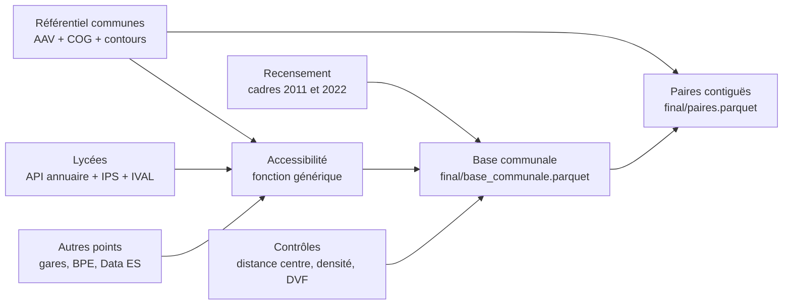

# Lycées et géographie des cadres dans trois aires urbaines de province

> **Projet** : Python pour la data science (ENSAE), groupe de 3 personnes
> **Rendu** : mardi 24 novembre 2026 · **Soutenance** : janvier 2027
> **Grille d'évaluation** : https://pythonds.linogaliana.fr/content/annexes/evaluation.html
> **Statut du document** : plan de référence du projet. Toute décision qui s'en écarte est notée dans le journal des décisions (section 13).

---

## Sommaire

0. Résumé du projet
1. Problématique, contexte et hypothèses
2. Périmètre et choix structurants (fixés avant de voir les résultats)
3. Sources de données
4. Construction de la base communale (pipeline)
5. Méthodologie d'analyse
6. Plan du rapport final
7. Organisation du dépôt
8. Conventions de travail
9. Calendrier, rôles et jalons
10. Risques et ordre de sacrifice
11. Checklist de rendu
12. Instructions pour Claude Code : par où commencer
13. Journal des décisions

---

## 0. Résumé du projet

**Question.** Dans des aires urbaines de province aux traditions scolaires contrastées, les communes offrant un meilleur accès à des lycées privés ou à forte valeur ajoutée concentrent-elles davantage de cadres que leurs voisines, et ce lien résiste-t-il face aux autres infrastructures ?

**Approche.**
- On construit une base à une ligne par commune pour trois aires d'attraction des villes (hors Paris), en croisant le recensement, les données de l'Éducation nationale et des données d'infrastructures.
- On mesure l'accès de chaque commune aux lycées, et non leur simple présence dans la commune.
- On compare les communes à position égale dans l'aire : par anneaux de distance au centre, puis par paires de communes contiguës.

**Statut des résultats.** Le projet décrit des associations, pas des effets causaux. Un résultat nul bien établi est un résultat valable et sera présenté comme tel.

---

## 1. Problématique, contexte et hypothèses

### 1.1 Contexte et littérature

- **Fack G. et Grenet J. (2010)**, « When do better schools raise housing prices? Evidence from Paris public and private schools », *Journal of Public Economics*, 94(1-2), p. 59-77. À Paris, une hausse d'un écart-type de la performance des collèges publics augmente les prix immobiliers de 1,4 à 2,4 %. Cet effet diminue quand l'offre privée à proximité augmente. C'est notre mécanisme de départ : l'offre scolaire entre dans les choix résidentiels, et le privé joue le rôle d'option de repli.
- **Black S. (1999)**, « Do Better Schools Matter? Parental Valuation of Elementary Education », *Quarterly Journal of Economics*. C'est la référence méthodologique sur la comparaison de logements situés de part et d'autre des limites de secteurs scolaires. Notre comparaison entre communes contiguës en est une version simplifiée.
- **Le contraste régional (DEPP, Repères et références statistiques).** En métropole, environ 78 % des élèves du second degré sont scolarisés dans le public, contre seulement six sur dix environ dans les académies de Rennes et de Nantes. Dans l'Ouest, le privé est un choix courant. On s'attend donc à ce qu'il y soit moins socialement sélectif.

### 1.2 Hypothèses

Elles sont fixées avant toute analyse. L'indicateur principal est défini en section 2.4.

| ID | Énoncé | Mesure | Test principal | Figure |
|----|--------|--------|----------------|--------|
| H1 | À distance égale du centre de l'aire, la part de cadres est plus élevée dans les communes ayant un meilleur accès aux lycées privés sous contrat. | `n_lyc_prive_5km` contre `part_cadres_2022` | Comparaison par anneaux de distance (5.2) et différences entre communes contiguës (5.3) | Fig. 4, 5 |
| H2 | Ce lien est plus faible dans l'aire de l'Ouest, où le privé est plus répandu. | H1 estimée aire par aire | Comparaison des écarts entre aires (5.4) | Fig. 4 (une facette par aire) |
| H3 | C'est la qualité des lycées accessibles (valeur ajoutée IVAL), plus que leur nombre, qui accompagne la hausse de la part de cadres entre 2011 et 2022. | `ival_moy_5km` contre `evol_cadres_pts`, à nombre de lycées égal | Section 5.5 | Fig. 6 |
| H4 | L'association avec les lycées est plus forte que celle avec les autres infrastructures (gares, médecins, équipements). | Même fonction d'accessibilité appliquée à chaque infrastructure | Section 5.7 | Fig. 7 |

### 1.3 Ce que le projet ne peut pas montrer

- **Causalité inverse.** Les lycées privés peuvent s'implanter ou se maintenir là où vivent déjà les familles aisées.
- **Sélection résidentielle non observée.** Les préférences des ménages ne sont pas mesurées.
- **Mesure d'accès imparfaite.** Les distances sont calculées à vol d'oiseau depuis un point de référence unique par commune.

Ces limites sont annoncées dès l'introduction du rapport et reprises dans la conclusion.

---

## 2. Périmètre et choix structurants (fixés avant de voir les résultats)

Fixer ces choix à l'avance évite de chercher la spécification qui « marche ». Toute modification est justifiée dans le journal des décisions (section 13).

### 2.1 Unité et géographie

- **Unité d'observation** : la commune. Pour Lyon, Marseille et Paris, ce sont les arrondissements municipaux.
- **Géographie de référence** : le Code officiel géographique (COG) au 1er janvier 2025, celui du recensement 2022. Toutes les sources sont ramenées à cette géographie grâce à la table de passage de l'Insee.
- **Projection** : Lambert 93 (EPSG:2154) pour tous les calculs de distance, en mètres. WGS84 (EPSG:4326) uniquement pour les cartes interactives.

### 2.2 Périmètre géographique

- **Trois aires d'attraction des villes** (zonage Insee 2020), pôle et couronne compris. Paris est exclu, à cause du poids des transports en commun.
- **Choix des aires (semaine 1, à partir des données).**
  - Candidates : Rennes, Nantes, Toulouse, Bordeaux, Lyon, Grenoble, Lille, Strasbourg.
  - Critères :
    - (a) au moins une aire de l'Ouest (Rennes ou Nantes) ;
    - (b) un contraste dans le poids du privé, mesuré par la part de lycées privés sous contrat et l'écart d'IPS moyen entre public et privé ;
    - (c) des tailles d'aire comparables ;
    - (d) au moins une dizaine de lycées privés par aire (seuil indicatif).
  - Le choix et ses justifications forment la section 3.1 du rapport.

### 2.3 Variable à expliquer

- **Principale** : la part des cadres et professions intellectuelles supérieures (groupe socioprofessionnel 3) parmi les actifs de 25 à 54 ans, en 2011 et en 2022.
  - **Source** : séries historiques de l'Insee (1968-2022). Elles donnent la même définition pour les deux années.
  - **Pourquoi 25-54 ans** : c'est l'âge des parents de lycéens, et cela neutralise les écarts de structure par âge (les retraités en particulier).
- **Dérivée** : `evol_cadres_pts` = part en 2022 moins part en 2011, en points de pourcentage.
- **Robustesse** : la part de cadres dans la population de 15 ans ou plus (recensement 2022, base « Évolution et structure de la population »).
- Le passage à la nomenclature PCS 2020 dans le recensement 2022 ne change pas les deux premiers niveaux. Le groupe des cadres reste donc comparable dans le temps.

### 2.4 Indicateur principal d'accès aux lycées (fixé maintenant)

- **Lycées retenus** : lycées d'enseignement général et technologique, et lycées polyvalents, publics et privés sous contrat. Les lycées professionnels seuls, les lycées agricoles et le privé hors contrat sont exclus de l'indicateur principal et réintégrés en robustesse.
- **Point de référence de la commune** : son centroïde géométrique. Le chef-lieu (point mairie de la couche ADMIN EXPRESS de l'IGN) est une alternative testée en robustesse.
- **Rayon principal : 5 km.** Les rayons de 3 et 10 km servent en robustesse.
- **Indicateurs calculés pour chaque commune** :
  - `n_lyc_prive_5km`, `n_lyc_public_5km` : nombre de lycées dans le rayon ;
  - `dist_lyc_prive_min`, `dist_lyc_public_min` : distance au plus proche, en km ;
  - `ival_moy_5km` : valeur ajoutée moyenne des lycées dans le rayon, pondérée par le nombre d'élèves présents au bac si l'information est disponible.
- **Effet de bord** : on inclut les lycées situés jusqu'à 10 km au-delà de la limite de l'aire. Sans cela, les communes du bord paraîtraient artificiellement mal desservies.

### 2.5 Variables de contrôle et « mauvais contrôles »

- **Contrôles** :
  - `dist_centre_km` : distance au centroïde de la commune-centre de l'aire, la commune la plus peuplée du pôle ;
  - `densite` : habitants par km² ;
  - `aire` : effet fixe, c'est-à-dire qu'on compare toujours à l'intérieur d'une même aire.
- **Mauvais contrôles**, jamais utilisés comme contrôles dans la spécification principale :
  - le niveau de vie médian (Filosofi), qui est en grande partie une conséquence de la part de cadres ;
  - l'IPS des lycées, construit à partir de la profession des parents et donc quasi mécaniquement lié à la part de cadres.
  - Ces deux variables restent purement descriptives.
- **Prix immobiliers (DVF)** : ils sont à la fois cause et conséquence. On les présente avec et sans ce contrôle, et on discute l'écart.

---

## 3. Sources de données

Priorité : **P1** = indispensable aux hypothèses H1 à H3, **P2** = partie 5 et contrôles, **P3** = bonus si le temps le permet.
Les URL marquées « à confirmer » doivent être vérifiées en semaine 1, et le lien direct de téléchargement copié dans `config.py`.

### 3.1 Tableau des sources

| # | Source | Producteur | Maille | Accès | Rôle | Priorité |
|---|--------|-----------|--------|-------|------|----------|
| 1 | Séries historiques : population active de 25-54 ans par CSP (1968-2022) — https://www.insee.fr/fr/statistiques/1893185 | Insee | Commune | Fichier | Variable à expliquer (2011, 2022) | P1 |
| 2 | Recensement 2022, « Évolution et structure de la population » — https://www.insee.fr/fr/statistiques/8581696 | Insee | Commune | Fichier ou API (`pynsee`) | Population, densité, robustesse (cadres 15 ans ou plus) | P1 |
| 3 | Annuaire de l'éducation — https://data.education.gouv.fr/explore/dataset/fr-en-annuaire-education/api/ | Ministère de l'Éducation nationale | Établissement (point) | **API** Opendatasoft | Liste des lycées, statut public/privé, coordonnées | P1 |
| 4 | Adresse et géolocalisation des établissements — https://www.data.gouv.fr/datasets/adresse-et-geolocalisation-des-etablissements-denseignement-des-premier-et-second-degres | Ministère de l'Éducation nationale | Point | Fichier ou API | Coordonnées de secours si l'annuaire en manque | P1 |
| 5 | IPS des lycées (à partir de 2023) — https://www.data.gouv.fr/datasets/ips-lycees-a-partir-de-2023 | DEPP | Établissement | Fichier ou API | Descriptif : écart public/privé par aire (choix des aires, H2) | P1 |
| 6 | IVAL, lycées d'enseignement général et technologique — https://www.data.gouv.fr/datasets/6707515c84dfa4012c3ecd45 | DEPP | Établissement | Fichier ou API | Qualité des lycées (H3) | P1 |
| 7 | Contours communaux (IGN ADMIN EXPRESS via `cartiflette`) — https://github.com/inseefrlab/cartiflette | IGN / InseeFrLab | Commune (polygone) | Package Python | Géométries, centroïdes, contiguïté | P1 |
| 8 | Zonage en aires d'attraction des villes 2020 (table d'appartenance des communes) — insee.fr, *à confirmer* | Insee | Commune | Fichier | Périmètre, pôle et couronne, commune-centre | P1 |
| 9 | Table de passage annuelle des codes communes (COG) — insee.fr, *à confirmer* | Insee | Commune | Fichier | Harmonisation des géographies | P1 |
| 10 | DVF géolocalisées — https://www.data.gouv.fr/datasets/demandes-de-valeurs-foncieres-geolocalisees | DGFiP / Etalab | Transaction (point) | Fichier par département | Prix médian au m² (contrôle discuté) | P2 |
| 11 | Filosofi 2021, communes — https://www.insee.fr/fr/statistiques/7756855?sommaire=7756859 | Insee | Commune | Fichier | Descriptif uniquement | P2 |
| 12 | Gares de voyageurs — https://data.gouv.fr/fr/datasets/gares-de-voyageurs-1 | SNCF Gares & Connexions | Point | Fichier ou API | H4 : accès au train | P2 |
| 13 | APL aux médecins généralistes — https://www.observatoire-des-territoires.gouv.fr/accessibilite-potentielle-localisee-apl-aux-medecins-generalistes | DREES | Commune | Fichier | H4 : santé (indicateur déjà calculé en accessibilité) | P2 |
| 14 | Base permanente des équipements, équipements géolocalisés — https://www.data.gouv.fr/datasets/base-permanente-des-equipements-2 | Insee | Point | Fichier | H4 : équipements culturels et services | P2 |
| 15 | Data ES, équipements sportifs — https://www.data.gouv.fr/datasets/recensement-des-equipements-sportifs-espaces-et-sites-de-pratiques-2 | Ministère des Sports | Point | Fichier ou API | H4 : sport | P2 |
| 16 | Migrations résidentielles, fichier détail MIGCOM 2022 — https://www.insee.fr/fr/statistiques/8589767 | Insee | Individu (Parquet, environ 17 millions de lignes) | Fichier | Bonus : soldes migratoires de cadres | P3 |
| 17 | Fiscalité locale des particuliers — https://data.economie.gouv.fr/explore/dataset/fiscalite-locale-des-particuliers-geo | DGFiP | Commune | API | Bonus : taux de taxe foncière | P3 |
| 18 | Aménagements cyclables — https://www.data.gouv.fr/datasets/60a37b7f303fdf4f2654b73d | Geovelo / OpenStreetMap | Ligne | Parquet | Bonus : cadre de vie | P3 |

### 3.2 Points d'attention à documenter dans le rapport (encadré « choix et biais »)

- **IPS** : les données du privé ne sont pas comparables avant 2023, car la remontée des professions des parents s'y est fortement améliorée. On n'utilise que la série à partir de 2023. L'IPS reste descriptif (voir 2.5).
- **IVAL** : c'est une mesure relative, qui ne couvre que le public et le privé sous contrat, et qui comprend plusieurs indicateurs (taux de réussite, taux d'accès de la seconde au bac, taux de mentions). Indicateur principal : **valeur ajoutée du taux d'accès de la seconde au bac**, car il reflète le parcours complet de l'élève. Le taux de réussite sert en robustesse. Décalage temporel : les IVAL sont récents, alors que l'évolution des cadres porte sur 2011-2022. Si l'ancienne version des IVAL sur data.gouv.fr le permet, on vérifie que les valeurs ajoutées sont stables dans le temps.
- **Filosofi** : le millésime 2021 est le dernier de l'ancien dispositif. Le millésime 2023 (Filosofi 2) n'est pas comparable et ne fournit que deux indicateurs à la commune.
- **Secret statistique et petites communes** : on signale les communes de moins de 200 actifs de 25-54 ans (seuil indicatif). Les moyennes sont pondérées par le nombre d'actifs. On teste aussi l'exclusion de ces communes.
- **DVF** : fenêtre de cinq ans glissants. On utilise les ventes d'appartements et de maisons sur 2020-2024, puis la médiane du prix au m² par commune, à condition d'avoir au moins 10 ventes (sinon valeur manquante, signalée).

---

## 4. Construction de la base communale (pipeline)



Chaque étape correspond à une fonction de `src/cadres_lycees/`. Elle lit les données brutes depuis S3 (et les télécharge si elles n'y sont pas encore), puis écrit son résultat sur S3. Chaque étape se termine par des **vérifications** (`assert`) qui font échouer le code bruyamment si une jointure perd des lignes.

| Étape | Fonction(s) | Sortie | Vérifications |
|-------|-------------|--------|---------------|
| A. Référentiel | `geo.referentiel_communes(aires)` | GeoDataFrame des communes des 3 aires : `code_commune`, `aire`, `pole_couronne`, `geometry`, `centroide`, `dist_centre_km` | Nombre de communes égal à celui de la table AAV ; codes uniques ; aucune géométrie vide |
| B. Cadres | `collecte.series_historiques_csp()`, `nettoyage.part_cadres()` | `part_cadres_2011`, `part_cadres_2022`, `evol_cadres_pts`, `actifs_2022` | Parts comprises entre 0 et 1 ; moins de 1 % de communes sans correspondance après passage au COG 2025 |
| C. Lycées | `collecte.annuaire_education(departements)`, `collecte.ips_lycees()`, `collecte.ival_lycees()`, `nettoyage.lycees_geo()` | GeoDataFrame des lycées : `uai`, `secteur`, `type`, `ips`, `ival_acces`, `ival_reussite`, `geometry` | Identifiants UAI uniques ; part des lycées géolocalisés > 98 % ; part des lycées avec IVAL indiquée dans le rapport |
| D. Accessibilité | `accessibilite.indicateurs(communes, points, rayons, filtre, attribut)` | Colonnes `n_<x>_<r>km`, `dist_<x>_min`, `<attr>_moy_<r>km` | Tests unitaires sur données jouets (`tests/test_accessibilite.py`) |
| E. Contrôles | `collecte.dvf(departements)`, `nettoyage.prix_m2()`, `nettoyage.densite()` | `prix_m2_med`, `densite`, `niveau_vie_med` (descriptif) | Nombre de ventes par commune ; règle du seuil de 10 ventes appliquée |
| F. Paires | `geo.paires_contigues(communes)` | Une ligne par paire (i < j) de communes qui se touchent dans une même aire, avec les écarts `d_part_cadres`, `d_n_lyc_prive_5km`, etc. | Pas de doublon (i,j)/(j,i) ; les deux communes appartiennent à la même aire |
| G. Table finale | `pipeline.construire_base()` | `final/base_communale.parquet`, `final/paires.parquet`, `docs/dictionnaire_variables.md` | Une ligne par commune ; dictionnaire à jour |

---

## 5. Méthodologie d'analyse

Rappel : l'ENSAE n'attend plus de partie modélisation. L'analyse repose sur des comparaisons transparentes. Une régression linéaire peut apparaître, uniquement comme outil descriptif (« à distance au centre égale, l'écart vaut… »), jamais comme exercice de prédiction.

### 5.1 Descriptif (sections 3.1 à 3.3 du rapport)
- **Fig. 1** : pour chaque aire, part de lycées privés et écart d'IPS public/privé. Justifie le choix des aires et motive H2.
- **Fig. 2** : part de cadres selon la distance au centre, avec une courbe lissée par aire. Montre pourquoi il faut comparer à distance égale.
- **Fig. 3** : carte interactive de l'accès aux lycées (folium ou plotly), avec les lycées en points colorés selon le statut public/privé.

### 5.2 H1 : comparaison par anneaux de distance
- **Anneaux** : 0-5, 5-10, 10-20, 20-30 et plus de 30 km du centre. Les bornes sont ajustées si un anneau compte moins de 15 communes, et ces ajustements sont documentés.
- Dans chaque anneau et chaque aire, on compare la part moyenne de cadres, pondérée par les actifs, des communes **avec** au moins un lycée privé à 5 km et des communes **sans**.
- Intervalles de confiance par **bootstrap** sur les communes (1 000 tirages).
- **Fig. 4** : graphique en barres ou en points avec intervalles ; un panneau par aire, les anneaux en abscisse. C'est la figure centrale du rapport.

### 5.3 H1 : différences entre communes contiguës
- Pour chaque paire de communes qui se touchent : `d_part_cadres` comparé à `d_n_lyc_prive_5km`.
- **Logique** : tout ce que deux voisines partagent (marché de l'emploi, climat, prix régionaux) s'annule dans la différence.
- **Fig. 5** : nuage de points regroupé par classes (binned scatter), avec la pente d'une régression des écarts de part de cadres sur les écarts d'accès.
- **Limite** : les paires ne sont pas indépendantes, car une même commune apparaît dans plusieurs paires. Les intervalles sont calculés par bootstrap **par commune**, et non par paire.

### 5.4 H2 : hétérogénéité entre aires
- On répète 5.2 et 5.3 aire par aire, puis on compare les écarts. Ce sont les facettes de la Fig. 4.

### 5.5 H3 : qualité ou simple présence
- **Population** : les communes ayant au moins un lycée accessible.
- On croise `evol_cadres_pts` avec `ival_moy_5km` (en terciles), à nombre de lycées accessibles comparable et anneau par anneau.
- **Fig. 6** : graphique en terciles d'IVAL, une couleur par aire.

### 5.6 Robustesse (un tableau récapitulatif)
- Rayons de 3 et 10 km.
- Résultats avec et sans le contrôle des prix au m².
- Part de cadres parmi les 15 ans ou plus (recensement 2022) à la place des 25-54 ans.
- Lycées professionnels et privé hors contrat inclus.
- Commune-centre exclue.
- Communes de moins de 200 actifs exclues.
- **Autocorrélation spatiale** : indice I de Moran (packages `esda` et `libpysal`, contiguïté de type Queen) sur `part_cadres_2022`, puis sur les écarts restants après comparaison par anneaux. On interprète ce que cela implique pour les intervalles de confiance.

### 5.7 H4 : lycées et autres infrastructures
- La même fonction `accessibilite.indicateurs` est appliquée aux gares, aux équipements sportifs (Data ES) et aux équipements culturels (BPE). L'APL est utilisée directement, puisqu'elle est déjà calculée par la DREES.
- Toutes les mesures d'accès sont standardisées (centrées réduites) à l'intérieur de chaque aire. On compare leurs associations avec la part de cadres, anneau par anneau et dans les paires contiguës.
- **Fig. 7** : un point par infrastructure avec son intervalle de confiance, triés de la plus forte à la plus faible association.

### 5.8 Règle contre la multiplication des tests
- Seules les spécifications de la section 2.4 constituent les résultats principaux. Tout le reste est présenté comme robustesse ou exploration.
- Si une hypothèse est infirmée, on le dit clairement : on ne cherche pas une autre spécification jusqu'à ce que « ça marche ».

---

## 6. Plan du rapport final (`rapport.ipynb`, publié avec Quarto)

**Titre : « À quelques kilomètres près : lycées et géographie des cadres dans trois aires urbaines de province »**

0. **Résumé** en cinq lignes : la question, les données, le résultat principal, la limite principale.
1. **Introduction**
   - 1.1 Pourquoi les lycées : Fack et Grenet (2010), le contraste régional public/privé.
   - 1.2 Question et hypothèses H1 à H4 (tableau de la section 1.2).
   - 1.3 Ce que le projet peut et ne peut pas montrer.
2. **Construire la base : une ligne par commune, quatre familles de variables**
   - 2.1 Schéma du pipeline et tableau des sources.
   - 2.2 Variable à expliquer.
   - 2.3 Variable d'intérêt : l'accessibilité aux lycées (définition, rayon, effet de bord).
   - 2.4 Contrôles et mauvais contrôles.
   - 2.5 Encadré « choix et biais ».
3. **Trois aires, trois profils**
   - 3.1 Pourquoi ces trois aires (Fig. 1).
   - 3.2 Le gradient centre-périphérie des cadres (Fig. 2).
   - 3.3 La géographie de l'accès aux lycées (Fig. 3).
4. **À position égale, l'accès aux lycées fait-il une différence ?**
   - 4.1 Comparaison par anneaux (Fig. 4).
   - 4.2 Comparaison entre communes contiguës (Fig. 5).
   - 4.3 L'Ouest est-il différent ?
   - 4.4 Qualité ou présence ? (Fig. 6)
   - 4.5 Robustesse : tableau récapitulatif et indice de Moran.
5. **Les lycées face aux autres infrastructures** (Fig. 7).
6. **Conclusion**
   - Tableau des hypothèses (confirmée, nuancée ou infirmée).
   - Limites.
   - Pistes : échelle IRIS, flux migratoires MIGCOM, temps de trajet.
7. **Annexes**
   - Reproduire le projet.
   - Dictionnaire des variables.
   - Journal des décisions.

**Règles de rédaction.**
- Chaque figure a un titre qui énonce le message (et pas seulement le sujet), des axes nommés avec leurs unités et une source. Elle est suivie de deux ou trois phrases d'interprétation.
- Aucune sortie brute (`describe()`, `head()`) n'est laissée sans commentaire dans le rapport final.
- Le code long vit dans `src/`. Les cellules du rapport appellent des fonctions et ne copient-collent jamais de code d'une cellule à l'autre.
- Taille visée : 7 figures principales, 1 tableau de robustesse, une lecture de 20 à 25 minutes.

---

## 7. Organisation du dépôt

```
projet-cadres-lycees/
├── README.md                  # question, résultats clés, comment reproduire
├── PLAN.md                    # ce document
├── CLAUDE.md                  # consignes pour Claude Code (importe PLAN.md)
├── pyproject.toml             # dépendances (gérées avec uv)
├── uv.lock
├── .gitignore                 # data/, .env, __pycache__, _site/, .ipynb_checkpoints
├── .pre-commit-config.yaml    # nb-clean : retire les sorties des notebooks
├── _quarto.yml                # rendu du rapport en site web (GitHub Pages)
├── rapport.ipynb              # LE notebook rendu, exécutable de bout en bout
├── src/cadres_lycees/
│   ├── __init__.py
│   ├── config.py              # aires, rayons, URL, chemins S3, CRS : toutes les constantes ici
│   ├── stockage.py            # lecture et écriture Parquet sur S3, cache local en secours
│   ├── collecte.py            # une fonction par source (téléchargement et cache)
│   ├── nettoyage.py           # harmonisation COG, filtres, variables dérivées
│   ├── geo.py                 # référentiel communes, centroïdes, distances, paires contiguës
│   ├── accessibilite.py       # fonction générique d'accessibilité
│   ├── analyse.py             # anneaux, bootstrap, comparaisons, indice de Moran
│   ├── figures.py             # une fonction par figure, avec une charte graphique commune
│   └── pipeline.py            # construire_base() enchaîne les étapes A à G
├── tests/
│   ├── test_accessibilite.py
│   └── test_geo.py
├── notebooks/exploration/     # brouillons individuels, jamais rendus (prefixe_initiales_sujet.ipynb)
└── docs/
    └── dictionnaire_variables.md
```

**Stockage des données.** Les données sont sur le S3 du SSPCloud, dans `s3://<utilisateur>/projet-cadres-lycees/`, avec trois sous-dossiers : `raw/` (fichiers sources inchangés), `interim/` (étapes intermédiaires) et `final/`. Les identifiants viennent des variables d'environnement injectées par le SSPCloud, jamais du code. Les fichiers de `final/` sont rendus publics en lecture pour que le correcteur puisse les charger.

---

## 8. Conventions de travail

### 8.1 Git
- La branche `main` est protégée : personne n'y pousse directement.
- Une branche par tâche : `feat/collecte-lycees`, `fix/jointure-cog`, `docs/intro`.
- Chaque branche est fusionnée via une pull request **relue par un autre membre**.
- Les tâches sont des *issues* GitHub. Chaque pull request référence son issue (`Closes #12`).
- Commits petits et fréquents, messages à l'impératif (« Ajoute la fonction d'accessibilité »).
- Jamais deux personnes sur `rapport.ipynb` en même temps : on prévient le groupe avant d'y toucher. `nb-clean` est installé en *pre-commit* pour retirer les sorties des notebooks.

### 8.2 Code
- Python 3.13 et dépendances déclarées dans `pyproject.toml`. Gestion avec `uv`, comme dans l'environnement du cours.
- Dépendances principales : `pandas`, `geopandas`, `pyarrow`, `duckdb`, `s3fs`, `requests`, `pynsee`, `cartiflette`, `libpysal`, `esda`, `matplotlib`, `plotly`, `folium`, `jupyter`, `nb-clean`, `pytest`.
- Fonctions documentées (docstring), annotations de type et noms en français cohérents avec le dictionnaire des variables.
- Aucun chemin ni aucune URL en dur hors de `config.py`.
- Les fonctions de collecte sont **idempotentes** : si le fichier brut est déjà sur S3, elles ne le retéléchargent pas.

### 8.3 Usage de l'IA générative (politique du cours)
- Le cours autorise les assistants de code utilisés avec discernement, mais **interdit le vibe coding** et sanctionne les usages abusifs.
- Chaque membre doit pouvoir expliquer, en soutenance, tout le code du dépôt, et en particulier `accessibilite.py` et `analyse.py`.
- Les interprétations des résultats et le texte du rapport sont écrits par le groupe.

---

## 9. Calendrier, rôles et jalons

**Rôles** (chacun est référent d'une dimension, tout le monde code partout) :
- **R1, collecte** : étapes A, B, C, E et sources P2 ;
- **R2, analyse spatiale** : étapes D et F, sections 5.2 à 5.7 ;
- **R3, visualisation et rapport** : `figures.py`, Quarto, structure du rapport, pilotage de la semaine 6.

| Semaine | R1 collecte | R2 analyse spatiale | R3 visualisation et rapport | Jalon de fin de semaine |
|---------|-------------|---------------------|-----------------------------|-------------------------|
| **S1** 13-18 oct | Confirmer les URL (sources 8 et 9) ; `stockage.py` ; collecte de l'annuaire par API | `geo.referentiel_communes` pour les 8 aires candidates | Dépôt, `pyproject`, pre-commit, Quarto ; squelette de `rapport.ipynb` | **Note de cadrage envoyée au chargé de TD** et choix des 3 aires (Fig. 1 provisoire) |
| **S2** 19-25 oct | Étapes B et C (cadres, lycées, IPS, IVAL) ; harmonisation COG | `accessibilite.py` et ses tests sur données jouets | Charte graphique ; Fig. 1 et 2 | Base communale v0 sur S3, avec les variables des étapes A à C |
| **S3** 26 oct-1 nov | Étape E (DVF, densité) ; début des sources P2 | Étapes D et F sur données réelles ; anneaux | Fig. 3 (carte interactive) ; rédaction des sections 2 et 3 | Base v1 complète pour H1 à H3 ; premières comparaisons |
| **S4** 2-8 nov | Sources P2 (gares, BPE, Data ES, APL) | H1 (anneaux et paires), H2, H3 | Fig. 4, 5 et 6 en version de travail ; rédaction de la section 4 | **Point de décision le 8 novembre** ; **premier test complet sur un SSPCloud neuf** |
| **S5** 9-15 nov | Bonus P3 si de l'avance (MIGCOM avec DuckDB) | H4 ; robustesse ; indice de Moran | Fig. 7 ; versions finales des figures | Analyse complète ; deuxième test complet |
| **S6** 16-22 nov | README, dictionnaire, nettoyage du code | Relecture croisée de la méthode | Rédaction finale : résumé, conclusion, limites | **Gel du code le 22 novembre** |
| **23-24 nov** | Tous | Tous | Tous | Exécution sur un SSPCloud neuf, publication Quarto, **rendu le 24 novembre** |

**Point de décision du 8 novembre.** Il ne sert pas à changer de question.
- Si H1 à H3 sont traitées et robustes, la semaine 5 couvre H4 en entier.
- Sinon, la semaine 5 consolide d'abord H1 à H3, et H4 est réduite à deux infrastructures (gares et APL).

**Soutenance (décembre-janvier).** Le support est construit autour des Fig. 1, 2, 4 et 7. Une répétition chronométrée est prévue, avec une liste de questions probables (pourquoi 5 km ? pourquoi pas de causalité ? que fait votre fonction d'accessibilité ?).

---

## 10. Risques et ordre de sacrifice

| Risque | Probabilité | Parade |
|--------|-------------|--------|
| Le notebook ne tourne pas de bout en bout (moyenne impossible) | Moyenne | Test complet hebdomadaire dès la S4 ; gel du code le 22 novembre |
| Codes communes non concordants entre sources | Élevée | Table de passage dès la S2 ; vérification par `assert` après chaque jointure |
| Trop peu de lycées privés dans certaines couronnes | Moyenne | Indicateur d'accès par rayon ; critère (d) dans le choix des aires |
| L'API de l'annuaire change ou tombe | Faible | Copie des données brutes sur S3 dès le premier téléchargement ; source 4 en secours |
| Fichiers DVF volumineux | Moyenne | Téléchargement par département, filtrage immédiat, Parquet |
| Retard global | Moyenne | Ordre de sacrifice ci-dessous |

**Ordre de sacrifice en cas de retard :**
1. abandonner les bonus P3 ;
2. réduire H4 à deux infrastructures ;
3. abandonner l'indice de Moran (le mentionner dans les limites) ;
4. passer à deux aires au lieu de trois.

**À ne jamais sacrifier** : la section 4.2 (paires contiguës), qui fait l'originalité du projet, et l'exécution complète du notebook.

---

## 11. Checklist de rendu (24 novembre)

- [ ] `rapport.ipynb` s'exécute de bout en bout sans erreur sur un service SSPCloud **neuf**, en suivant uniquement le README.
- [ ] Les données sont chargées depuis leurs URL d'origine ou depuis S3, avec des fichiers publics en lecture.
- [ ] Les dépendances s'installent en une commande (`uv sync`).
- [ ] Chaque figure a un titre qui énonce le message, des axes nommés, une source et une interprétation.
- [ ] Le résumé, le tableau des hypothèses et les limites sont présents.
- [ ] Le site Quarto est publié et son lien figure dans le README.
- [ ] L'historique Git montre des commits réguliers des trois membres et des pull requests relues.
- [ ] Aucun secret (jeton, identifiant S3) n'apparaît dans le dépôt.
- [ ] Le journal des décisions est à jour.

---

## 12. Instructions pour Claude Code : par où commencer

### 12.1 Cadre
Tu assistes un groupe de trois étudiants sur un projet noté. Le cours interdit le *vibe coding*. Les étudiants doivent comprendre et pouvoir défendre chaque ligne. En conséquence :
- Travaille **par petites étapes**, en suivant l'ordre des tickets ci-dessous. Une seule fonction ou un seul fichier à la fois.
- **Explique** brièvement chaque choix non trivial (jointure, projection, filtre) dans ta réponse et dans les docstrings.
- **N'invente jamais** un nom de colonne, un code ou une URL. Charge d'abord un échantillon, affiche le schéma (`df.columns`, `df.dtypes`, `df.head()`), puis écris le code. Si une URL est marquée « à confirmer », demande-la.
- **Ne rédige pas** les interprétations de résultats ni le texte du rapport. Propose au plus une structure.
- Respecte les choix fixés en section 2. Si tu penses qu'un choix doit changer, propose-le et attends la validation. Les étudiants l'ajouteront au journal des décisions.
- Toutes les constantes vont dans `config.py`. Aucun secret dans le code.
- Termine chaque ticket en indiquant les commandes pour tester ce qui a été fait, ainsi qu'un message de commit proposé.

### 12.2 Tickets de démarrage (dans cet ordre)

**T0. Squelette du dépôt.** Crée l'arborescence de la section 7 : `pyproject.toml` (dépendances de la section 8.2, Python 3.13, `cartiflette` installé depuis GitHub), `.gitignore`, `.pre-commit-config.yaml` avec nb-clean, un `config.py` minimal et un README squelette.
*Fait quand* : `uv sync` fonctionne et `python -c "import cadres_lycees"` ne lève pas d'erreur.

**T1. `stockage.py`.** Fonctions `ecrire_parquet(df, chemin)` et `lire_parquet(chemin)`. Elles utilisent S3 via `s3fs` si les variables d'environnement AWS sont présentes, et un dossier local `data/` sinon. Ajoute aussi `existe(chemin)`.
*Fait quand* : un aller-retour écriture puis lecture d'un petit DataFrame fonctionne en local.

**T2. `collecte.annuaire_education(departements)`.** Télécharge via l'API Opendatasoft de data.education.gouv.fr (point d'export plutôt que pagination si possible), filtre sur les départements demandés et les lycées, stocke le brut dans `raw/`.
- Commence par interroger l'API sur 10 lignes et affiche le schéma.
- Repère avec les étudiants les champs de statut public/privé, de type d'établissement, de voies de formation et de coordonnées.
*Fait quand* : un GeoDataFrame des lycées des départements de test est produit, avec le compte par statut affiché.

**T3. `geo.referentiel_communes(aires)`.** Contours via `cartiflette` (vérifier la signature actuelle de `carti_download` dans la documentation du package), passage en Lambert 93, centroïdes, appartenance aux aires (source 8, URL à fournir par les étudiants), commune-centre et `dist_centre_km`.
*Fait quand* : les vérifications de l'étape A (section 4) passent pour une aire de test.

**T4. `accessibilite.indicateurs(...)`.** Signature :
`indicateurs(communes, points, rayons=(3, 5, 10), prefixe="lyc_prive", attribut=None, marge_km=10) -> DataFrame`.
- Utilise une jointure spatiale par zone tampon (buffer) ou `sjoin_nearest`.
- Inclut les points situés jusqu'à `marge_km` au-delà de l'aire.
- Écris d'abord les tests (`tests/test_accessibilite.py`) sur une grille jouet dont les résultats se calculent à la main.
*Fait quand* : `pytest` passe.

**T5. `collecte.series_historiques_csp()` et `nettoyage.part_cadres()`.** Télécharge le fichier, identifie avec les étudiants les colonnes des actifs de 25 à 54 ans et des cadres pour 2011 et 2022, puis harmonise vers le COG 2025.
*Fait quand* : les vérifications de l'étape B passent.

**T6. Figure 1 provisoire (choix des aires).** Pour les 8 aires candidates : part de lycées privés sous contrat et écart d'IPS public/privé. Fonction dans `figures.py`, appelée depuis `rapport.ipynb`.
*Fait quand* : la figure s'affiche et les étudiants peuvent trancher sur les aires.

### 12.3 Prompt de démarrage suggéré
> « Lis PLAN.md, en particulier les sections 2, 4, 7, 8 et 12. Commence par le ticket T0. Avant d'écrire du code, résume en cinq lignes ce que tu vas faire et attends ma validation. »

---

## 13. Journal des décisions

| Date | Décision | Raison | Auteur |
|------|----------|--------|--------|
| 13/10/2026 | Rayon principal 5 km ; lycées généraux, technologiques et polyvalents, privés sous contrat ; variable cible : cadres parmi les actifs de 25-54 ans | Fixé avant les résultats (section 2) | Groupe |
| | | | |
